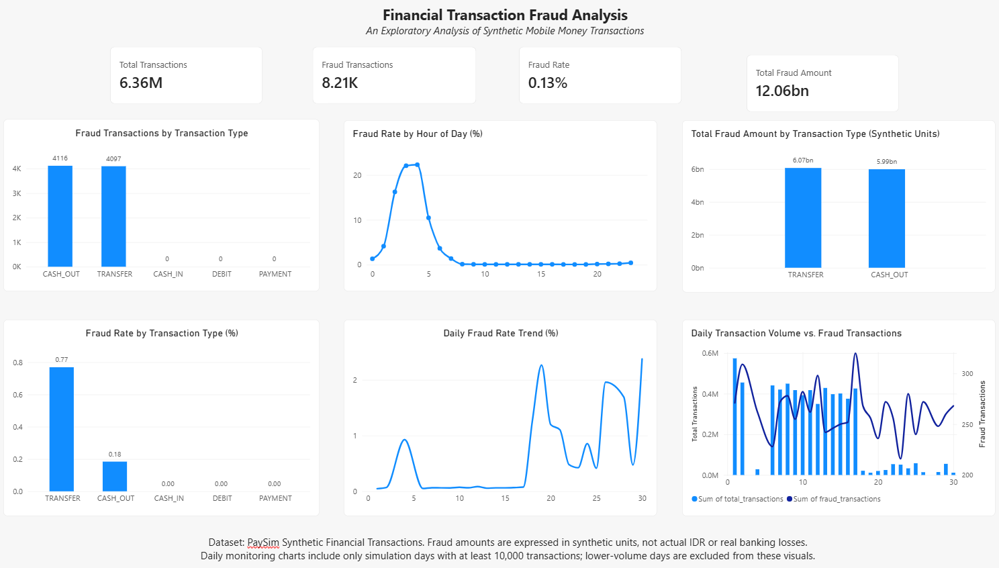

# Financial Transaction Fraud Analysis

An end-to-end data analytics project focused on exploring synthetic financial transaction data, identifying fraud patterns, and presenting actionable insights through Python, PostgreSQL, and Power BI.

## Project Overview

Financial fraud is a significant challenge in the financial services industry. Identifying suspicious transaction patterns and understanding fraudulent activities are important steps toward improving transaction monitoring.

This project analyzes the **PaySim Synthetic Financial Dataset** to explore fraudulent transaction patterns, compare fraud rates across transaction types, examine transaction activity over time, and present key findings through an interactive Power BI dashboard.

The project follows a data analytics workflow, starting with data understanding and preprocessing, followed by exploratory data analysis (EDA), SQL-based analysis, and dashboard development.

> **Dataset Disclaimer:** PaySim is a synthetic mobile money transaction dataset. It does not contain actual customer transactions or represent real banking losses. All transaction amounts are expressed in synthetic units, not Indonesian Rupiah (IDR).

## Project Objectives

- Understand the structure and characteristics of financial transaction data.
- Clean and preprocess transaction records for analysis.
- Identify fraudulent transaction patterns and distributions.
- Analyze fraud rates across transaction types and transaction hours.
- Examine daily transaction volume and fraud trends.
- Use SQL to perform structured transaction analysis.
- Build an interactive Power BI dashboard to communicate analytical findings.
- Provide data-driven insights and recommendations for transaction monitoring.

## Dataset Description

**Dataset:** PaySim Synthetic Financial Datasets for Fraud Detection

**Source:** [Kaggle – PaySim Synthetic Financial Datasets for Fraud Detection](https://www.kaggle.com/datasets/ealaxi/paysim1)

The dataset simulates mobile money transactions and contains the following original columns:

| Column | Description |
|---|---|
| step | Time step of the transaction |
| type | Transaction type |
| amount | Transaction amount |
| nameOrig | Originating customer |
| oldbalanceOrg | Originating balance before transaction |
| newbalanceOrig | Originating balance after transaction |
| nameDest | Destination customer |
| oldbalanceDest | Destination balance before transaction |
| newbalanceDest | Destination balance after transaction |
| isFraud | Indicates whether the transaction is fraudulent |
| isFlaggedFraud | Indicates whether the transaction was flagged by the simulation |

### Dataset Statistics

| Metric | Value |
|---|---:|
| Total Transactions | 6,362,620 |
| Normal Transactions | 6,354,407 |
| Fraud Transactions | 8,213 |
| Fraud Rate | 0.1291% |
| Original Columns | 11 |
| Missing Values | 0 |
| Duplicate Records | 0 |

The dataset has a highly imbalanced class distribution, with fraudulent transactions representing approximately 0.1291% of all records.

## Tools & Technologies

| Tool / Technology | Purpose |
|---|---|
| Python | Data processing and analysis |
| Pandas | Data manipulation and preprocessing |
| NumPy | Numerical operations and feature engineering |
| Matplotlib | Data visualization |
| Jupyter Notebook | Exploratory analysis and documentation |
| PostgreSQL | Database management and SQL analysis |
| SQL | Transaction aggregation and fraud analysis |
| Microsoft Power BI | Interactive dashboard development |

## Project Structure

```text
financial-transaction-fraud-analysis/
│
├── data/
│   ├── raw/
│   └── processed/
│
├── notebooks/
│   ├── 01_data_understanding.ipynb
│   ├── 02_data_cleaning.ipynb
│   └── 03_exploratory_data_analysis.ipynb
│
├── powerbi/
│   └── Financial_Transaction_Fraud_Analysis.pbix
│
├── dashboard/
│   └── dashboard_preview.png
│
├── reports/
│   ├── eda_outputs/
│   └── sql_outputs/
│
├── sql/
│   ├── create_tables.sql
│   └── fraud_analysis_queries.sql
│
├── .gitignore
└── requirements.txt
```

The raw and processed datasets are excluded from this repository because of their large file sizes. Please download the original dataset from the Kaggle source provided above.

## Project Workflow

### 1. Data Understanding

**Notebook:** `01_data_understanding.ipynb`

The initial analysis focuses on understanding the dataset structure, data types, transaction distribution, and data quality.

Key activities:
- Inspect dataset dimensions and column information.
- Analyze transaction type distribution.
- Examine fraud and non-fraud class distribution.
- Check missing values and duplicate records.
- Identify the class imbalance problem.

### 2. Data Cleaning and Feature Engineering

**Notebook:** `02_data_cleaning.ipynb`

The preprocessing stage includes:
- Checking and handling missing values.
- Checking duplicate records.
- Validating transaction amounts and transaction labels.
- Optimizing data types to improve memory efficiency.
- Creating additional analytical features.

Additional features:

| Feature | Description |
|---|---|
| hour_of_day | Extracted transaction hour from the simulation step |
| simulation_day | Extracted simulation day |
| is_transfer_or_cashout | Indicates whether a transaction is TRANSFER or CASH_OUT |
| amount_log | Log-transformed transaction amount using `log1p()` |

After preprocessing, the dataset contains 15 columns, including the original and engineered features.

### 3. Exploratory Data Analysis (EDA)

**Notebook:** `03_exploratory_data_analysis.ipynb`

EDA is performed to identify patterns and characteristics of fraudulent transactions.

The analysis includes:
- Fraud distribution by transaction type.
- Fraud rate by transaction type.
- Fraud distribution by transaction hour.
- Daily transaction volume and fraud trends.
- Average transaction amount by fraud status.
- Fraud rate analysis across simulation days.

The analysis processes the large dataset in chunks to reduce memory consumption.

### 4. SQL Analysis with PostgreSQL

**SQL Files:**
- `sql/create_tables.sql`
- `sql/fraud_analysis_queries.sql`

PostgreSQL is used to store and analyze the cleaned transaction dataset.

SQL analysis includes:
1. Overall fraud statistics.
2. Fraud rate by transaction type.
3. Fraud amount analysis.
4. Fraud trends by transaction hour.
5. Daily transaction monitoring.

Aggregation results are exported as CSV files and used as supporting outputs for reporting and dashboard development.

### 5. Power BI Dashboard

**Dashboard File:** `powerbi/Financial_Transaction_Fraud_Analysis.pbix`

An interactive Power BI dashboard was developed to summarize the main findings and provide an overview of fraudulent transaction patterns.

The dashboard includes four KPI cards:
- Total Transactions
- Fraud Transactions
- Fraud Rate
- Total Fraud Amount

It also contains six visualizations:
1. Fraud Transactions by Transaction Type.
2. Fraud Rate by Transaction Type.
3. Fraud Rate by Hour of Day.
4. Daily Fraud Rate Trend.
5. Total Fraud Amount by Transaction Type.
6. Daily Transaction Volume vs. Fraud Transactions.

### Dashboard Preview



## Key Findings

### 1. Overall Fraud Distribution

- The dataset contains 8,213 fraudulent transactions out of 6,362,620 total transactions.
- The overall fraud rate is approximately 0.1291%.
- Fraudulent transactions represent a very small portion of total transaction activity.

### 2. Fraud by Transaction Type

Fraudulent transactions were found in two transaction types:

| Transaction Type | Fraud Transactions | Fraud Rate |
|---|---:|---:|
| TRANSFER | 4,097 | 0.7688% |
| CASH_OUT | 4,116 | 0.1840% |
| CASH_IN | 0 | 0% |
| DEBIT | 0 | 0% |
| PAYMENT | 0 | 0% |

TRANSFER has a fraud rate approximately 4.18 times higher than CASH_OUT, although CASH_OUT has slightly more fraudulent transactions.

### 3. Fraud Patterns by Hour

The highest observed fraud rates occur during early morning hours:

| Hour | Fraud Rate |
|---:|---:|
| 3 | 22.08% |
| 4 | 22.30% |

However, transaction volumes during these hours are relatively low. Therefore, these results should be interpreted carefully and should not be treated as definitive evidence that early morning transactions are inherently riskier.

### 4. Fraud Amount Analysis

| Transaction Type | Total Fraud Amount | Average Fraud Amount |
|---|---:|---:|
| TRANSFER | 6,067,213,184.01 | 1,480,891.67 |
| CASH_OUT | 5,989,202,243.83 | 1,455,102.59 |

Although CASH_OUT has more fraudulent transactions, TRANSFER has a slightly higher total fraud amount and average fraud amount.

All amounts represent synthetic dataset units, not actual currency or financial losses.

## Business Insights & Recommendations

Based on the exploratory analysis, the following recommendations can be considered for transaction monitoring:

1. **Prioritize TRANSFER transactions for further investigation.** Their observed fraud rate is higher than CASH_OUT in this dataset.

2. **Monitor CASH_OUT transactions.** CASH_OUT accounts for the largest number of fraudulent transactions in the dataset.

3. **Examine unusual transaction activity by time.** Early morning hours show higher observed fraud rates, but additional validation with sufficient transaction volumes is necessary.

4. **Use multiple indicators for monitoring.** Transaction type, transaction amount, transaction timing, and transaction patterns can help support further investigation.

5. **Consider class imbalance when developing future detection systems.** Fraudulent transactions are extremely rare compared with normal transactions, which should be considered in any future predictive modeling work.

These recommendations are exploratory findings based on synthetic data and should not be directly interpreted as operational banking policies.

## Limitations

- The dataset is synthetic and simulates mobile money transactions rather than actual banking transactions.
- The analysis may not fully represent real-world financial fraud patterns.
- The dataset has a highly imbalanced fraud distribution.
- High fraud rates in low-volume periods require further investigation before drawing conclusions.
- The daily transaction monitoring output includes only simulation days with at least 10,000 transactions. Lower-volume days are excluded from that particular monitoring visualization.
- This project focuses on descriptive and diagnostic data analytics. It does not implement a machine learning fraud prediction model.

## How to Run the Project

### 1. Clone the Repository

```bash
git clone https://github.com/Theofit31/financial-transaction-fraud-analysis.git

cd financial-transaction-fraud-analysis
```

### 2. Create a Python Environment

```bash
python -m venv .venv
```

Activate the environment on Windows using Git Bash:

```bash
source .venv/Scripts/activate
```

### 3. Install Dependencies

```bash
pip install -r requirements.txt
```

### 4. Download the Dataset

Download the PaySim dataset from Kaggle:

[PaySim Synthetic Financial Datasets for Fraud Detection](https://www.kaggle.com/datasets/ealaxi/paysim1)

Place the original CSV file in:

```text
data/raw/PS_20174392719_1491204439457_log.csv
```

### 5. Run the Notebooks

Execute the notebooks in the following order:

1. `01_data_understanding.ipynb`
2. `02_data_cleaning.ipynb`
3. `03_exploratory_data_analysis.ipynb`

The cleaning notebook generates the processed transaction dataset, while the EDA notebook generates analytical summaries and visualizations.

### 6. Run SQL Analysis

Create a PostgreSQL database and execute:

```sql
sql/create_tables.sql
```

Import the processed CSV into the `transactions` table using PostgreSQL `\copy` from the `psql` terminal. Use the column order defined in `sql/create_tables.sql` and `sql/fraud_analysis_queries.sql`.

Then execute:

```sql
\i 'sql/fraud_analysis_queries.sql'
```

### 7. Open the Power BI Dashboard

Open:

```text
powerbi/Financial_Transaction_Fraud_Analysis.pbix
```

The dashboard and exported analytical results are available in the repository.

## Future Improvements

Potential future extensions include:
- Developing a machine learning-based fraud detection model.
- Evaluating classification models with metrics suitable for imbalanced datasets.
- Exploring additional transaction behavior patterns.
- Improving dashboard interactivity with additional filters and drill-through analysis.

## Author

**Theo Filus Iglesias Triadi**

*This project was developed for learning and portfolio purposes to demonstrate practical skills in data analytics, SQL, and business intelligence.*
